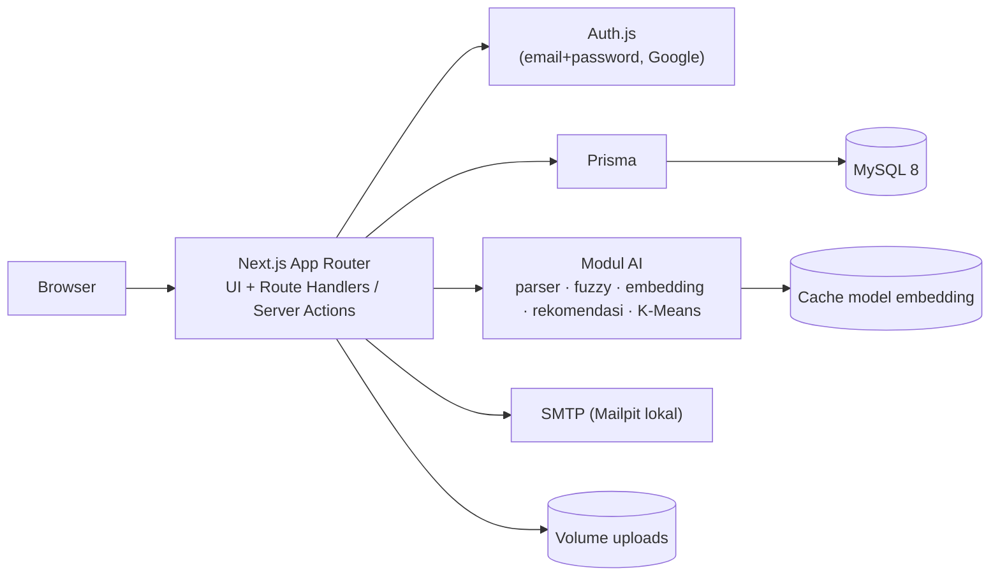

# INVESTYUK — Product Requirements Document (PRD)

| | |
|---|---|
| **Produk** | INVESTYUK (Investment Information & Intelligence) |
| **Klien simulasi** | Pemerintah Kabupaten ABC (Diskominfo) |
| **Konteks** | Tugas besar Manajemen Proyek, S1 Informatika (simulasi, bukan proyek nyata) |
| **Versi / status** | 0.1 / Draf |
| **Tanggal** | 27 Oktober 2026 |
| **Dokumen terkait** | `INVESTYUK_ERD.md` (rancangan database + `schema.prisma`) |

> Prioritas fitur (Must / Should / Could) pada dokumen ini adalah **usulan** untuk mengendalikan lingkup. Semua fitur sudah disepakati masuk; prioritas hanya menentukan urutan pengerjaan dan apa yang dipotong lebih dulu bila waktu mepet.

---

## 1. Ringkasan produk

**INVESTYUK** adalah website sistem informasi investasi daerah yang memusatkan informasi sektor unggulan, peluang investasi, lokasi, prosedur, dan persyaratan, serta menyediakan jalur komunikasi (inquiry dan tracking) antara calon investor dan pemerintah daerah. Fitur Sistem Cerdas yang sederhana dan dapat dipertanggungjawabkan membantu pengguna menemukan informasi yang relevan.

**Sifat produk:** edukatif dan informatif. Tidak ada transaksi investasi di dalam sistem, dan AI tidak mengambil keputusan investasi.

### 1.1 Tujuan

1. Menyajikan informasi peluang investasi secara terpusat, transparan, dan mudah diakses.
2. Membantu pengguna menemukan peluang yang relevan lewat **smart search**, **rekomendasi**, dan **pengelompokan** (clustering).
3. Menyediakan mekanisme **inquiry** dan **tracking tindak lanjut** tanpa mewajibkan akun.
4. Menyediakan **dashboard** bagi dinas dan admin untuk mengelola data dan memantau inquiry.
5. Melindungi data pribadi calon investor sesuai prinsip UU PDP.

### 1.2 Di luar lingkup (versi ini)

- Transaksi atau pembayaran investasi.
- AI yang memberi saran/keputusan investasi.
- Asisten tanya-jawab (RAG/chatbot LLM) → **pengembangan lanjutan**.
- Hosting publik (versi ini berjalan lokal dengan Docker Compose).
- Dark mode, aplikasi mobile native, notifikasi WhatsApp/SMS.

---

## 2. Pengguna & peran

| Peran | Siapa | Kebutuhan utama | Perlu login? |
|---|---|---|---|
| **Pengunjung** | Masyarakat/pelajar yang ingin belajar investasi | Membaca edukasi, sektor, prosedur | Tidak |
| **Investor** | Calon investor | Mencari peluang, membandingkan, mengajukan inquiry, melacak tindak lanjut | Tidak wajib (akun opsional untuk riwayat dan peluang tersimpan) |
| **Dinas** | Staf dinas/OPD pembina sektor | Mengelola peluang di sektornya, menanggapi inquiry yang ditugaskan | Ya (akun dibuat/diundang admin) |
| **Admin** | Pengelola Diskominfo | Mengelola semua data, menugaskan inquiry, memantau statistik, mengelola AI, membaca audit log | Ya |

**Prinsip akses:** semua halaman publik, pencarian, rekomendasi, bandingkan, peta, edukasi, inquiry, dan lacak inquiry **bisa dipakai tanpa akun**. Login hanya untuk riwayat investor dan area dinas/admin.

---

## 3. Keputusan desain yang sudah disepakati

| Aspek | Keputusan |
|---|---|
| Stack | Next.js (fullstack), MySQL, Prisma, Tailwind CSS + shadcn/ui; pelengkap Recharts, react-leaflet, next-intl |
| Autentikasi | Auth.js: email + password dan login Google; peran disimpan di database; sesi JWT |
| Smart search | Hybrid: semantic (embedding lokal) + pemahaman kueri bahasa alami; fallback keyword/fuzzy |
| Rekomendasi | Rule-based scoring + content-based filtering |
| Pengelompokan | Kategori manual (sektor/kecamatan) + K-Means |
| Gaya visual | Modern fintech dengan sentuhan formal pemerintahan; mengikuti mockup Beranda |
| Font | Plus Jakarta Sans (heading) + Inter (body) |
| Halaman tambahan | Edukasi, peta interaktif, bandingkan peluang, dua bahasa (ID/EN) |
| Data | Campuran: kerangka mengacu kondisi nyata, angka dan proyek fiktif; seed script |
| Perlindungan data | Level B: data minimal, persetujuan, audit log, masking, hak hapus/anonimkan |
| Kualitas tampilan | WCAG 2.1 AA, Lighthouse ≥ 90 |
| Pengujian | Vitest + Playwright untuk inti; UAT dan kompatibilitas manual; evaluasi AI dengan kueri uji |
| Deployment | Lokal dengan Docker Compose (hosting publik ditunda) |
| Alur inquiry | Baru → Diproses → Dibalas → Selesai; timeline dan balasan; notifikasi email |

---

## 4. Peta situs & navigasi

### 4.1 Navbar

`Beranda` · `Potensi Daerah ▾` (Profil, Sektor Unggulan, Lokasi & Proyek) · `Peluang Investasi` · `Panduan Investasi ▾` (Prosedur & Persyaratan, Edukasi, FAQ) · `Tentang Kami` · ikon cari · `Lacak Inquiry` (tautan kecil) · pilihan bahasa `ID | EN` · `Masuk` (tombol ringan).

### 4.2 Rute

Bahasa Indonesia sebagai default tanpa prefix; bahasa Inggris dengan prefix `/en` (`next-intl`, `localePrefix: 'as-needed'`).

| Rute | Halaman | Peran |
|---|---|---|
| `/` | Beranda | Publik |
| `/potensi` | Profil potensi investasi | Publik |
| `/sektor`, `/sektor/[slug]` | Daftar dan detail sektor | Publik |
| `/peluang`, `/peluang/[slug]` | Daftar (grid/peta) dan detail peluang | Publik |
| `/bandingkan?ids=1,2,3` | Bandingkan 2–3 peluang | Publik |
| `/rekomendasi` | Form preferensi → hasil rekomendasi | Publik |
| `/prosedur` | Alur dan persyaratan | Publik |
| `/edukasi`, `/edukasi/[slug]` | Artikel edukasi | Publik |
| `/faq` | Pertanyaan umum | Publik |
| `/inquiry` | Form inquiry | Publik |
| `/lacak` | Lacak inquiry (kode + email) | Publik |
| `/tentang`, `/kebijakan-privasi`, `/syarat` | Informasi dan legal | Publik |
| `/masuk`, `/daftar`, `/lupa-password` | Autentikasi | Publik |
| `/akun` | Riwayat inquiry dan peluang tersimpan | Investor |
| `/dashboard` | Ringkasan KPI dan grafik | Dinas, Admin |
| `/dashboard/peluang`, `/dashboard/inquiry` | Kelola peluang, kelola inquiry | Dinas (sektornya), Admin |
| `/dashboard/sektor`, `/dashboard/konten`, `/dashboard/pengguna` | Sektor/kecamatan, artikel/prosedur/FAQ, pengguna & peran | Admin |
| `/dashboard/ai` | Pengelolaan AI | Admin |
| `/dashboard/audit` | Audit log | Admin |

---

## 5. Kebutuhan fungsional

Prioritas: **M** = Must, **S** = Should, **C** = Could.

### 5.1 Halaman publik

| ID | Kebutuhan | Pri |
|---|---|---|
| FR-PUB-01 | **Beranda search-first**: hero dengan kolom smart search besar, 4 contoh kueri yang bisa diklik, badge "Didukung AI", strip statistik, 6 kartu Akses Cepat, section Rekomendasi (mini form), Peluang Unggulan, kartu ajakan Inquiry | M |
| FR-PUB-02 | Statistik beranda (jumlah peluang, sektor, lokasi, inquiry) **dihitung dari database**, bukan teks tetap | M |
| FR-PUB-03 | Halaman sektor: daftar sektor dan detail (deskripsi, peluang di sektor tersebut, dinas pembina) | M |
| FR-PUB-04 | **Daftar peluang**: sidebar filter (sektor, kecamatan, kisaran nilai, kelompok K-Means) + grid kartu; urut Paling relevan / Terbaru / Nilai terendah / Nilai tertinggi; panel filter geser di ponsel | M |
| FR-PUB-05 | Toggle **Daftar / Peta** pada daftar peluang (peta Leaflet + OpenStreetMap, penanda per peluang, popup ringkas) | S |
| FR-PUB-06 | **Detail peluang**: dua kolom; kiri galeri, deskripsi, persyaratan/dokumen, peta; kanan sidebar sticky berisi ringkasan angka (nilai investasi, estimasi ROI, balik modal, luas lahan, tenaga kerja), badge sektor/kelompok, tombol **Ajukan Inquiry**, Simpan, Bandingkan; di ponsel sidebar menjadi bar bawah | M |
| FR-PUB-07 | **Peluang Serupa** di bawah detail (kemiripan embedding + fitur numerik) | S |
| FR-PUB-08 | **Bandingkan** maksimal 3 peluang berdampingan; pilihan disimpan di browser (localStorage) | S |
| FR-PUB-09 | Prosedur dan persyaratan: alur langkah, checklist dokumen, FAQ | M |
| FR-PUB-10 | Edukasi investasi: daftar artikel + detail (konten Markdown), kategori | S |
| FR-PUB-11 | Halaman Tentang, Kebijakan Privasi, Syarat Penggunaan, halaman 404/error, kondisi kosong dan loading yang konsisten | M |
| FR-PUB-12 | Peluang tersimpan untuk pengunjung tanpa akun disimpan di localStorage dan digabung ke akun saat login | C |

### 5.2 Sistem Cerdas

| ID | Kebutuhan | Pri |
|---|---|---|
| FR-AI-01 | **Pemahaman kueri**: kueri bahasa alami diurai menjadi filter (sektor, kecamatan, batas nilai investasi) dengan kamus sektor/kecamatan/sinonim dan parser angka ("500 juta", "1 miliar", "di bawah", "maksimal", "di atas") | M |
| FR-AI-02 | **Keyword + fuzzy search** (toleran typo) atas judul/ringkasan, kedua bahasa; berfungsi sebagai fallback | M |
| FR-AI-03 | **Semantic search**: kueri dan data peluang diubah menjadi vektor oleh model multibahasa lokal; skor kemiripan kosinus | S |
| FR-AI-04 | **Hybrid ranking**: skor akhir = bobot semantic + bobot keyword, dengan filter dari FR-AI-01 sebagai syarat mutlak; bobot awal 0,6 / 0,4 dan disetel dengan kueri uji | S |
| FR-AI-05 | Hasil pencarian menampilkan **skor relevansi** dan **chip filter yang terdeteksi** (bisa dihapus pengguna) agar transparan | M |
| FR-AI-06 | Bila model embedding gagal dimuat, sistem otomatis memakai FR-AI-02 tanpa pesan error ke pengguna | M |
| FR-AI-07 | **Rekomendasi (rule-based)**: input sektor (multi), kecamatan (multi), kisaran modal, prioritas opsional (balik modal cepat / ROI tinggi / padat karya); skor berbobot; tampilkan 6 teratas dengan **alasan** ("Cocok: sektor perikanan, di Kec. X, sesuai kisaran modal") | M |
| FR-AI-08 | **Pengelompokan K-Means** atas fitur numerik peluang; label klaster diberi nama manual; tampil sebagai filter "Kelompok peluang" dan badge di kartu | M |
| FR-AI-09 | **Pengelolaan AI** (admin): jalankan ulang K-Means (pilih K, lihat inertia/silhouette), edit label klaster, perbarui embedding, uji kueri dan lihat hasil terurai | S |
| FR-AI-10 | Semua keluaran AI diberi catatan "informasi bersifat estimasi, bukan nasihat keuangan"; AI tidak membuat keputusan investasi | M |

**Rincian metode (acuan dokumentasi luaran KAK #9):**

- **Pipeline pencarian:** normalisasi teks → stemming bahasa Indonesia → parser filter → (paralel) skor semantic dan skor fuzzy → fusi → terapkan filter → urutkan.
- **Embedding:** model multibahasa kecil yang berjalan lokal di server (kandidat: `multilingual-e5-small` lewat `transformers.js`; verifikasi ukuran dan kinerjanya saat implementasi). Vektor peluang dihitung saat seed/simpan dan disimpan di kolom JSON; hanya dihitung ulang bila `embeddingHash` berubah.
- **Rekomendasi (bobot awal, dapat disetel):** sektor 0,35 · lokasi 0,20 · kecocokan modal 0,25 · prioritas 0,20.
- **Peluang Serupa:** 0,6 kemiripan embedding + 0,4 kemiripan fitur numerik ternormalisasi; bonus kecil bila sektor sama.
- **K-Means:** fitur `investmentValue` (log-transform), `estRoiPercent`, `paybackYears`, `jobsEstimate`, `landAreaHa`; normalisasi min-max; inisialisasi k-means++ dengan seed tetap agar hasil dapat direplikasi; K dipilih dari 2–6 memakai elbow dan silhouette (default 4).

### 5.3 Inquiry & tracking

| ID | Kebutuhan | Pri |
|---|---|---|
| FR-INQ-01 | Form inquiry: nama, email, pesan (wajib); telepon, organisasi (opsional); peluang yang diminati (otomatis bila dari halaman detail); **checkbox persetujuan** dengan tautan Kebijakan Privasi | M |
| FR-INQ-02 | Sistem membuat **kode tracking** acak dan mengirimnya lewat email; perlindungan spam (rate limit + CAPTCHA) | M |
| FR-INQ-03 | **Lacak Inquiry**: input kode + email yang sama → timeline status dan balasan publik | M |
| FR-INQ-04 | Alur status **Baru → Diproses → Dibalas → Selesai**; tiap perubahan, penugasan, dan balasan tercatat sebagai event dan memicu email ke investor | M |
| FR-INQ-05 | Admin menugaskan inquiry ke dinas sesuai sektor (otomatis disarankan dari sektor peluang) | M |
| FR-INQ-06 | Dinas dapat membalas (pesan publik) dan menulis **catatan internal** (tidak terlihat investor) | M |
| FR-INQ-07 | Investor dengan akun melihat riwayat inquiry di `/akun`; inquiry lama dengan email sama dapat ditautkan setelah email terverifikasi | S |
| FR-INQ-08 | Permintaan **hapus/anonimkan data** dari investor; admin memprosesnya | S |

### 5.4 Akun & autentikasi

| ID | Kebutuhan | Pri |
|---|---|---|
| FR-AUTH-01 | Daftar dan masuk dengan email + password (hash argon2/bcrypt; rate limit login) | M |
| FR-AUTH-02 | Masuk dengan Google; akun baru otomatis berperan Investor | S |
| FR-AUTH-03 | Akun dinas/admin dibuat atau diundang admin; peran diubah hanya oleh admin | M |
| FR-AUTH-04 | Verifikasi email dan reset password lewat email | S |
| FR-AUTH-05 | Kontrol akses per peran di sisi server untuk semua halaman dan API dashboard (bukan hanya menyembunyikan menu) | M |

### 5.5 Dashboard dinas & admin

| ID | Kebutuhan | Pri |
|---|---|---|
| FR-DSH-01 | Ringkasan: KPI (jumlah peluang, inquiry per status), grafik inquiry per sektor dan tren, kata kunci pencarian populer | M |
| FR-DSH-02 | CRUD peluang (dua bahasa, upload gambar, koordinat, fitur numerik, status Draft/Published/Archived); dinas hanya sektornya | M |
| FR-DSH-03 | Kelola inquiry: daftar dengan filter status/sektor, kontak ter-*mask*, detail, ubah status, tugaskan, balas | M |
| FR-DSH-04 | CRUD sektor, kecamatan, prosedur, FAQ, artikel (admin) | M |
| FR-DSH-05 | Kelola pengguna dan peran (admin) | M |
| FR-DSH-06 | **Audit log**: akses kontak inquiry, perubahan status, perubahan data penting | S |
| FR-DSH-07 | Halaman Pengelolaan AI (lihat FR-AI-09) | S |

### 5.6 Dua bahasa

| ID | Kebutuhan | Pri |
|---|---|---|
| FR-I18N-01 | Seluruh antarmuka dan konten tersedia dalam ID dan EN; pilihan bahasa di navbar; pengaturan `next-intl` dilakukan **sejak awal proyek** (menambahkannya belakangan jauh lebih mahal) | S |
| FR-I18N-02 | Smart search berfungsi untuk kueri berbahasa Indonesia dan Inggris (didukung model multibahasa) | S |

---

## 6. Alur pengguna utama

1. **Cari → detail → inquiry → lacak.** Pengunjung mengetik kueri di Beranda → melihat hasil dengan skor dan chip filter → membuka detail peluang → klik Ajukan Inquiry → mengisi form dan menyetujui kebijakan privasi → menerima email berisi kode tracking → membuka `/lacak` dan memasukkan kode + email → melihat status dan balasan.
2. **Rekomendasi.** Pengunjung mengisi mini form di Beranda atau `/rekomendasi` → melihat 6 peluang beserta alasannya → membuka detail atau membandingkan.
3. **Tindak lanjut inquiry.** Inquiry masuk (Baru) → admin menugaskan ke dinas → dinas mengubah status ke Diproses, lalu membalas (Dibalas) → investor menerima email → dinas/admin menutup (Selesai).
4. **Pembaruan data.** Dinas menambah/mengubah peluang (Draft → Published) → embedding dihitung ulang otomatis → admin menjalankan ulang K-Means bila perlu.

### Kriteria penerimaan (contoh alur inti)

- **Given** pengunjung di Beranda, **when** mengetik "lahan perikanan di bawah 500 juta", **then** sistem menampilkan chip filter *Sektor: Perikanan* dan *Nilai ≤ Rp500.000.000*, dan semua hasil memenuhi kedua filter.
- **Given** model embedding tidak tersedia, **when** pengguna mencari, **then** hasil tetap muncul dari keyword/fuzzy tanpa error.
- **Given** form inquiry tanpa centang persetujuan, **when** dikirim, **then** ditolak dengan pesan yang jelas.
- **Given** kode tracking benar tetapi email berbeda, **when** dilacak, **then** sistem tidak menampilkan data apa pun dan tidak mengungkap bahwa kode itu ada.
- **Given** staf dinas sektor A, **when** mencoba membuka inquiry/peluang sektor B lewat URL langsung, **then** ditolak (403).
- **Given** admin menjalankan ulang K-Means, **when** selesai, **then** satu `cluster_runs` aktif, `clusterId` semua peluang `PUBLISHED` terisi, dan filter "Kelompok peluang" memakai hasil terbaru.

---

## 7. Kebutuhan non-fungsional (ISO/IEC 25010)

| Karakteristik | Kebutuhan dan target |
|---|---|
| **Kesesuaian fungsional** | Seluruh fitur Must lolos test case; keluaran AI diverifikasi dengan kueri uji |
| **Efisiensi kinerja** | Skor Lighthouse performa ≥ 90 (profil mobile); respons pencarian ≤ 1 detik pada ±40 data; gambar dioptimasi (`next/image`), font via `next/font` |
| **Kompatibilitas** | Chrome, Firefox, Edge, Safari terbaru; responsif untuk desktop, laptop, tablet, ponsel (breakpoint ≥ 360 px) |
| **Kebergunaan & aksesibilitas** | WCAG 2.1 AA; navigasi keyboard; label form; teks alternatif; kontras teks ≥ 4,5:1; target sentuh ≥ 44 px; teks sekunder tidak lebih terang dari `#475569` |
| **Keandalan** | Fallback pencarian saat model gagal; validasi input di server; penanganan error yang ramah (404/500) |
| **Keamanan** | Validasi input (mis. Zod); query lewat Prisma (parameterisasi); hash password; rate limit untuk login, inquiry, dan tracking; CAPTCHA pada inquiry; header keamanan (CSP, HSTS di produksi); kontrol akses di server; cek OWASP Top 10 pada pengujian keamanan; rahasia di `.env`, tidak masuk repo |
| **Pelindungan data pribadi** | Data minimal; persetujuan tercatat; masking kontak; audit log; anonimisasi; log pencarian anonim |
| **Pemeliharaan** | TypeScript; struktur modul jelas; migrasi Prisma; README dan manual developer |
| **Portabilitas** | Seluruh sistem berjalan dengan `docker compose up` |

---

## 8. Spesifikasi UI

### 8.1 Token desain

```css
:root {
  /* warna utama */
  --navy:      #0B2545;  /* utama, teks judul, tombol gelap */
  --blue:      #2563EB;  /* aksen, tautan, tombol utama (teks putih lolos AA) */
  --sky:       #38BDF8;  /* hanya di atas latar gelap/foto */
  --gold:      #D4A017;  /* badge resmi Pemkab */

  /* netral */
  --bg:        #F6F8FB;  /* latar halaman */
  --surface:   #FFFFFF;  /* kartu */
  --border:    #E2E8F0;
  --text:      #0F172A;
  --text-2:    #475569;  /* teks sekunder, jangan lebih terang */

  /* ikon kategori (latar pastel) */
  --tint-green:  #DCFCE7;
  --tint-purple: #EDE9FE;
  --tint-blue:   #DBEAFE;
  --tint-orange: #FFEDD5;
  --tint-pink:   #FCE7F3;
  --tint-teal:   #CCFBF1;

  /* bentuk */
  --radius-card: 16px;
  --radius-pill: 999px;
}
```

Tipografi: **Plus Jakarta Sans** untuk heading, **Inter** untuk body, keduanya via `next/font/google`; angka statistik dan tabel memakai `font-variant-numeric: tabular-nums`. Ikon: `lucide-react`.

### 8.2 Catatan per area

- **Navbar:** putih, sticky, tinggi ±64 px; tombol *Masuk* bergaya outline; *Daftar* tersedia di halaman masuk (login tidak wajib, jadi tidak ditonjolkan).
- **Hero Beranda:** foto lanskap daerah dengan **overlay gelap** (agar teks putih lolos kontras); judul dengan kata "Kabupaten ABC" berwarna `--sky`; kolom search berbentuk pil dengan ikon AI; baris "Contoh pencarian" berisi chip; badge "Didukung AI" (pencarian cerdas · rekomendasi · pengelompokan data).
- **Strip statistik:** kartu putih menumpuk di tepi bawah hero; 4 angka dengan ikon; nilai dari database.
- **Akses Cepat (6 kartu):** Sektor Unggulan · Peluang Investasi · Lokasi & Proyek · Prosedur & Persyaratan · Inquiry & Tracking · Edukasi & Informasi; ikon pada latar pastel.
- **Section Rekomendasi:** mini form (sektor, kecamatan, kisaran modal) dan hasil langsung di bawahnya.
- **Kartu peluang:** foto, badge sektor, badge kelompok, judul, kecamatan, nilai investasi (format Rupiah), tombol Bandingkan, panah ke detail.
- **Footer:** identitas Pemkab/Diskominfo, badge "Situs resmi" berwarna emas, tautan legal, kontak. Unsur formal pemerintahan dipusatkan di sini dan di badge.
- **Dashboard:** sidebar kiri (menu sesuai peran), konten kartu KPI + grafik (Recharts) + tabel (shadcn Table), tampilan lebih padat dibanding area publik.
- **Gambar:** gunakan foto berlisensi (Unsplash/Pexels) atau buatan sendiri; catat sumber dan lisensi di dokumen. Logo dibuat sendiri dan disimpan sebagai SVG.

---

## 9. Arsitektur & lingkungan



**Layanan Docker Compose:** `app` (Next.js), `db` (MySQL 8), `mailpit` (penangkap email dev), dengan volume untuk data MySQL, uploads, dan cache model embedding (agar model tidak diunduh ulang).

**Struktur proyek (usulan):**

```text
investyuk/
├─ docker-compose.yml
├─ Dockerfile
├─ .env.example
├─ prisma/
│  ├─ schema.prisma
│  ├─ seed.ts
│  └─ seed-data/            # sectors.json, districts.json, opportunities.json, ...
├─ messages/
│  ├─ id.json
│  └─ en.json
├─ src/
│  ├─ app/
│  │  ├─ [locale]/
│  │  │  ├─ (public)/        # beranda, peluang, sektor, rekomendasi, ...
│  │  │  ├─ (auth)/          # masuk, daftar, lupa-password
│  │  │  ├─ akun/
│  │  │  └─ dashboard/
│  │  └─ api/                # search, recommend, inquiries, track, ...
│  ├─ components/            # ui (shadcn), layout, peluang, dashboard
│  └─ lib/
│     ├─ ai/                 # parser, fuzzy, embedding, hybrid, recommend, kmeans
│     ├─ db.ts  auth.ts  mail.ts  audit.ts  tracking-code.ts  rate-limit.ts
└─ tests/
   ├─ unit/                  # Vitest
   ├─ e2e/                   # Playwright
   └─ ai-eval/               # kueri uji + skrip evaluasi
```

**Endpoint/aksi utama:** `GET /api/search`, `POST /api/recommend`, `POST /api/inquiries`, `POST /api/inquiries/track`, serta aksi dashboard (CRUD, ubah status, jalankan K-Means, perbarui embedding).

---

## 10. Data

Detail tabel ada di `INVESTYUK_ERD.md`. Spesifikasi **seed** (semua dua bahasa, angka fiktif):

| Data | Jumlah | Catatan |
|---|---|---|
| Dinas | 5–6 | Satu dinas dapat membina beberapa sektor |
| Sektor | 6–8 | Mis. Pertanian, Perikanan, Pariwisata, Industri, Perdagangan, Energi, Ekonomi Kreatif |
| Kecamatan | 8–10 | Dengan koordinat |
| Peluang | ±40 | Persebaran nilai sengaja membentuk 3–4 kelompok alami (lihat di bawah) |
| Prosedur | 6–8 langkah | |
| FAQ | ±10 | |
| Artikel edukasi | ±8 | |
| Akun uji | 1 admin, 2 dinas, 2 investor | Kata sandi uji hanya di `.env.example`/README |

**Rancangan sebaran agar K-Means bermakna:** UMKM/skala kecil (Rp100 juta–1 miliar, ROI tinggi, balik modal 2–4 tahun), skala menengah (Rp1–25 miliar), skala besar (Rp50–800 miliar, jangka panjang 8–12 tahun, padat karya). Karena rentang nilai investasi sangat lebar, fitur ini di-log-transform sebelum normalisasi.

**Pembuatan konten:** draf teks boleh dibantu AI, **wajib diverifikasi** tim (sejalan dengan KAK bagian K), termasuk terjemahan EN.

---

## 11. Pengujian

| Jenis (sesuai KAK) | Pendekatan |
|---|---|
| Unit | Vitest: parser kueri, fuzzy, skor rekomendasi, K-Means, pembuat kode tracking, aturan akses |
| Integrasi | Vitest + database uji: alur inquiry (buat → tugaskan → balas → selesai), anonimisasi |
| Sistem / E2E | Playwright: cari → detail → inquiry → lacak; login dinas → balas inquiry; ganti bahasa |
| Keamanan | Cek manual OWASP Top 10: akses lintas peran (IDOR), rate limit, validasi input, header keamanan |
| Kompatibilitas | Daftar browser dan perangkat; Lighthouse + axe untuk aksesibilitas/SEO/performa |
| UAT | Skenario per peran dan formulir penilaian pengguna uji |
| Sistem Cerdas | Lihat di bawah |
| Kualitas (ISO 25010) | Rekap hasil per karakteristik di bagian 7 |

**Evaluasi Sistem Cerdas:**
- Susun **≥ 30 kueri uji** (ID dan EN, ada typo, ada kalimat panjang, ada kueri berfilter angka) beserta peluang yang diharapkan muncul.
- Ukur **precision@5** untuk dua konfigurasi: keyword/fuzzy saja vs hybrid. Hasil perbandingan ini menjadi bukti nilai tambah AI di laporan (target awal hybrid ≥ 0,8).
- Rekomendasi: uji beberapa profil preferensi dan periksa alasan yang ditampilkan sesuai data.
- K-Means: laporkan elbow, silhouette, dan interpretasi tiap klaster.

---

## 12. Pemetaan ke KAK

| Luaran KAK (bagian E) | Dipenuhi oleh |
|---|---|
| 1. Website responsif | Aplikasi Next.js (bagian 4, 8) |
| 2. Source code JavaScript | Repositori (TypeScript/JavaScript) |
| 3. Database MySQL | `INVESTYUK_ERD.md`, `schema.prisma` |
| 4. SRS dan SDD | PRD ini + ERD + diagram arsitektur sebagai bahan |
| 5. Prototype/UI/UX | Mockup Beranda dan spesifikasi UI (bagian 8); prototipe halaman lain dibuat terpisah |
| 6. Smart search | FR-AI-01 s.d. FR-AI-06 |
| 7. Rekomendasi sederhana | FR-AI-07, FR-PUB-07 |
| 8. Pengelompokan | FR-AI-08, FR-AI-09 |
| 9. Dokumentasi data dan metode AI | Rincian metode (bagian 5.2), spesifikasi seed (bagian 10), laporan evaluasi (bagian 11) |
| 10. Test plan, test case, hasil, UAT | Bagian 11 dijabarkan menjadi dokumen uji |
| 11. Catatan konfigurasi instalasi | `README`, `docker-compose.yml`, `.env.example` |
| 12. User manual | Disusun dari alur pengguna (bagian 6) |
| 13. Developer/technical manual | Struktur proyek, ERD, arsitektur |

Catatan KAK lain: koordinasi berkala dengan Diskominfo (minimal 2 minggu sekali, dengan notula), RAB maksimal Rp400 juta, dan jadwal 3 Maret–31 Agustus 2027 merupakan bagian manajemen proyek dan dikerjakan di dokumen terpisah.

---

## 13. Risiko & mitigasi

| Risiko | Dampak | Mitigasi |
|---|---|---|
| Model embedding berat, lambat dimuat, atau gagal diunduh | Smart search lambat/mati saat demo | Model kecil, cache di volume, pemanasan saat server start, fallback otomatis (FR-AI-06) |
| Lingkup melebar (AI berlapis, ID/EN, peta, bandingkan) | Fitur inti tidak selesai | Prioritas M/S/C, urutan build di bagian 14, i18n diaktifkan sejak awal |
| Data fiktif tidak membentuk klaster yang bermakna | K-Means tampak acak | Rancang seed dengan sebaran sengaja (bagian 10); log-transform |
| Terjemahan EN dan konten ganda memakan waktu | Konten tidak lengkap | Bantuan AI untuk draf + verifikasi; EN dikerjakan setelah ID stabil |
| Ketergantungan Google OAuth/konfigurasi | Login Google gagal saat demo | Email + password tetap tersedia; Google berprioritas Should |
| Email tidak terkirim | Tracking tidak jalan | Mailpit lokal; kode tracking juga ditampilkan di layar setelah kirim |
| Kebocoran data pribadi | Pelanggaran prinsip PDP | Level B: masking, audit log, akses per peran, anonimisasi |
| Hak cipta foto/logo | Masalah lisensi | Sumber berlisensi, catat atribusi |
| Hasil AI keliru/mengarang | Menyesatkan investor | Tidak ada generatif bebas; hasil dari data; catatan "estimasi" |

---

## 14. Urutan pembangunan (fase)

| Fase | Isi | Hasil |
|---|---|---|
| 0. Fondasi | Repo, Next.js, Tailwind + shadcn, Prisma, Docker Compose, `next-intl`, token desain | `docker compose up` berjalan, halaman kosong dua bahasa |
| 1. Data | `schema.prisma`, migrasi, seed lengkap | Database terisi ±40 peluang |
| 2. Halaman publik inti | Layout, Beranda, sektor, daftar + detail peluang, prosedur, FAQ, edukasi | Situs informatif dapat dijelajahi |
| 3. Pencarian & AI dasar | Parser kueri, fuzzy, rekomendasi rule-based, K-Means, filter kelompok | Fitur AI Must berfungsi |
| 4. Inquiry & auth | Form inquiry, tracking, email, Auth.js, peran | Alur inquiry end-to-end |
| 5. Dashboard | KPI, CRUD, kelola inquiry, pengguna | Dinas/admin dapat mengelola |
| 6. Peningkatan | Semantic + hybrid, peta, bandingkan, Peluang Serupa, Pengelolaan AI, audit log, hak hapus | Fitur Should selesai |
| 7. Mutu & dokumentasi | Pengujian otomatis dan manual, evaluasi AI, Lighthouse/axe, perbaikan, manual, laporan | Siap demo dan serah terima |

Fase 0–2 dapat menghasilkan situs yang sudah layak ditunjukkan; fase 3–4 melengkapi inti KAK; fase 6 adalah yang paling aman dipotong bila waktu terbatas.

---

## 15. Hal yang masih perlu diputuskan / disiapkan

- Nama dan ide **logo**, serta sumber foto hero dan kartu peluang.
- Isi teks **Kebijakan Privasi** dan **Syarat Penggunaan** (bisa dibuat dari template lalu disesuaikan).
- Layanan **CAPTCHA** yang dipakai (mis. Cloudflare Turnstile atau hCaptcha) dan cara menjalankannya di lingkungan lokal.
- Cara penyimpanan **upload gambar** (usulan: volume Docker lokal dengan validasi tipe dan ukuran).
- Kata kunci/sinonim awal untuk kamus parser kueri (sektor, kecamatan, istilah umum).
- Pembagian tugas bila dikerjakan berkelompok.
- Tanggal target nyata tugas (jadwal KAK adalah jadwal simulasi proyek).
