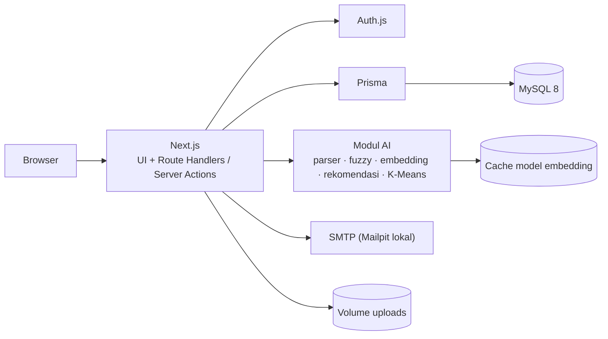

# INVESTYUK

**Investment Information & Intelligence**: website informasi peluang investasi daerah Kabupaten ABC dengan pencarian cerdas, rekomendasi, dan pengelompokan peluang.


<!-- Tambahkan tangkapan layar aplikasi di docs/screenshots/ lalu aktifkan baris di bawah:

-->

> **Status proyek: tahap perancangan.** Desain, PRD, dan rancangan database sudah selesai (lihat [Dokumentasi](#dokumentasi)). Kode aplikasi dibangun bertahap sesuai [Roadmap](#roadmap). Instruksi pada bagian [Memulai](#memulai) adalah target yang berlaku setelah fase 0 dan 1 selesai; sesuaikan bila struktur akhir berbeda.

> **Catatan:** INVESTYUK adalah proyek akademik (tugas besar mata kuliah Manajemen Proyek, S1 Informatika) berdasarkan Kerangka Acuan Kerja (KAK) simulasi. **Kabupaten ABC bersifat fiktif**, dan seluruh angka investasi, lokasi proyek, serta konten adalah data contoh.

---

## Tentang

Pemerintah daerah membutuhkan media digital yang menyajikan informasi peluang investasi secara terpusat, transparan, dan mudah diakses. INVESTYUK menjawab kebutuhan itu dengan:

- Informasi sektor unggulan, peluang investasi, lokasi/proyek, prosedur, dan persyaratan dalam satu tempat.
- Jalur komunikasi antara calon investor dan pemerintah daerah lewat **inquiry** dan **tracking tindak lanjut**, tanpa mewajibkan akun.
- **Sistem Cerdas** sederhana yang membantu pengguna menemukan peluang yang relevan.
- **Dashboard** bagi dinas dan admin untuk mengelola data dan memantau inquiry.

INVESTYUK bersifat **edukatif dan informatif**. Tidak ada transaksi investasi di dalamnya, dan AI tidak memberi saran atau keputusan investasi.

## Fitur

**Untuk pengunjung dan investor (tanpa login)**
- Beranda *search-first* dengan kolom pencarian cerdas, statistik, dan peluang unggulan
- Sektor unggulan, daftar dan detail peluang, peta lokasi interaktif
- Filter sektor, kecamatan, kisaran nilai, dan kelompok peluang
- Bandingkan hingga 3 peluang, serta "Peluang Serupa"
- Rekomendasi berdasarkan preferensi (sektor, lokasi, kisaran modal)
- Prosedur dan persyaratan, FAQ, artikel edukasi investasi
- Inquiry dengan kode tracking dan halaman Lacak Inquiry
- Dua bahasa: Indonesia dan Inggris

**Untuk investor terdaftar (opsional)**
- Riwayat inquiry dan peluang tersimpan
- Masuk dengan email + password atau akun Google

**Untuk dinas dan admin**
- Dashboard ringkasan (KPI, grafik, kata kunci populer)
- Kelola peluang, sektor, kecamatan, prosedur, FAQ, dan artikel
- Kelola inquiry: penugasan, balasan, catatan internal, perubahan status
- Kelola pengguna dan peran, audit log, serta halaman Pengelolaan AI (khusus admin)

### Sistem Cerdas

| Fitur | Pendekatan |
|---|---|
| **Smart search** | Pemahaman kueri bahasa alami (mis. "lahan perikanan di bawah 500 juta" diurai menjadi filter) + semantic search dengan model embedding multibahasa lokal + keyword/fuzzy sebagai fallback |
| **Rekomendasi** | Rule-based scoring dari preferensi pengguna + content-based filtering untuk "Peluang Serupa"; setiap hasil disertai alasan |
| **Pengelompokan** | Kategori manual (sektor, kecamatan) + K-Means atas fitur numerik peluang |

Semua keluaran berasal dari data di database dan diberi catatan bahwa informasi bersifat estimasi, bukan nasihat keuangan.

## Tech stack

| Lapisan | Teknologi |
|---|---|
| Framework | Next.js (App Router), JavaScript/TypeScript |
| Database | MySQL 8 |
| ORM | Prisma |
| UI | Tailwind CSS, shadcn/ui, lucide-react |
| Grafik & peta | Recharts, react-leaflet (OpenStreetMap) |
| Internasionalisasi | next-intl |
| Autentikasi | Auth.js (email + password, Google) |
| Pengujian | Vitest, Playwright, Lighthouse, axe |
| Lingkungan | Docker Compose (app, MySQL, Mailpit) |

## Arsitektur



## Memulai

### Prasyarat

- [Docker](https://docs.docker.com/get-docker/) dan Docker Compose
- (Opsional, untuk pengembangan tanpa Docker) Node.js 20 atau lebih baru dan MySQL 8

### Menjalankan dengan Docker Compose

```bash
# 1. Ambil kode
git clone <url-repo-anda> investyuk
cd investyuk

# 2. Siapkan variabel lingkungan
cp .env.example .env
# edit .env: terutama AUTH_SECRET (lihat tabel di bawah)

# 3. Jalankan semua layanan
docker compose up -d --build

# 4. Buat tabel dan isi data contoh
docker compose exec app npx prisma migrate deploy
docker compose exec app npx prisma db seed
```

Setelah selesai:

| Layanan | Alamat |
|---|---|
| Aplikasi | http://localhost:3000 (Inggris: http://localhost:3000/en) |
| Mailpit (kotak masuk email uji) | http://localhost:8025 |
| MySQL | `localhost:3306` |

> Saat pertama kali dijalankan, model embedding diunduh dan disimpan di volume cache, jadi permintaan pencarian pertama bisa lebih lambat. Bila model belum siap, pencarian otomatis memakai keyword/fuzzy.

### Menjalankan tanpa Docker (pengembangan)

```bash
npm install
cp .env.example .env          # arahkan DATABASE_URL ke MySQL lokal
npx prisma migrate dev
npx prisma db seed
npm run dev
```

### Akun uji

Setelah seed, tersedia akun contoh untuk admin, dinas, dan investor. Daftar email dan kata sandi ujinya ada di `.env.example` / `prisma/seed-data/` (hanya untuk lingkungan pengembangan; **jangan dipakai di produksi**).

## Variabel lingkungan

Salin `.env.example` menjadi `.env`, lalu isi:

| Variabel | Keterangan | Contoh |
|---|---|---|
| `DATABASE_URL` | Koneksi MySQL | `mysql://root:password@db:3306/investyuk` |
| `AUTH_SECRET` | Rahasia sesi Auth.js (acak, minimal 32 karakter) | hasil `openssl rand -base64 32` |
| `AUTH_URL` | URL dasar aplikasi | `http://localhost:3000` |
| `AUTH_GOOGLE_ID` / `AUTH_GOOGLE_SECRET` | Kredensial OAuth Google (opsional; tanpa ini tombol Google dinonaktifkan) | dari Google Cloud Console |
| `SMTP_HOST` / `SMTP_PORT` | Server email (lokal: Mailpit) | `mailpit` / `1025` |
| `MAIL_FROM` | Alamat pengirim | `INVESTYUK <no-reply@investyuk.local>` |
| `CAPTCHA_SITE_KEY` / `CAPTCHA_SECRET_KEY` | Kunci CAPTCHA untuk form inquiry (penyedia belum ditentukan; opsional di lokal) | |
| `EMBEDDING_MODEL` | Model embedding lokal untuk semantic search | diisi sesuai model yang dipilih |
| `UPLOAD_DIR` | Folder penyimpanan unggahan gambar | `/app/uploads` |

> Nama variabel Auth.js mengikuti versi yang dipakai; sesuaikan bila berbeda.
> File `.env` **tidak boleh** di-commit. Pastikan sudah ada di `.gitignore`.

## Struktur proyek

```text
investyuk/
├─ docker-compose.yml
├─ Dockerfile
├─ .env.example
├─ prisma/
│  ├─ schema.prisma
│  ├─ seed.ts
│  └─ seed-data/               # sektor, kecamatan, peluang, FAQ, artikel (ID/EN)
├─ messages/                   # terjemahan: id.json, en.json
├─ src/
│  ├─ app/
│  │  ├─ [locale]/
│  │  │  ├─ (public)/          # beranda, peluang, sektor, rekomendasi, ...
│  │  │  ├─ (auth)/            # masuk, daftar, lupa-password
│  │  │  ├─ akun/              # riwayat inquiry & peluang tersimpan
│  │  │  └─ dashboard/         # dinas & admin
│  │  └─ api/                  # search, recommend, inquiries, track
│  ├─ components/
│  └─ lib/
│     ├─ ai/                   # parser, fuzzy, embedding, hybrid, recommend, kmeans
│     └─ db.ts auth.ts mail.ts audit.ts tracking-code.ts rate-limit.ts
├─ tests/
│  ├─ unit/                    # Vitest
│  ├─ e2e/                     # Playwright
│  └─ ai-eval/                 # kueri uji dan skrip evaluasi (precision@5)
└─ docs/                       # PRD, ERD, tangkapan layar
```

## Skrip

Skrip npm yang direncanakan (nama final mengikuti `package.json`):

| Perintah | Fungsi |
|---|---|
| `npm run dev` | Server pengembangan |
| `npm run build` / `npm start` | Build dan jalankan produksi |
| `npm run lint` | Linter |
| `npm test` | Unit dan integrasi (Vitest) |
| `npm run test:e2e` | Uji end-to-end (Playwright) |
| `npm run test:ai` | Evaluasi Sistem Cerdas dengan kueri uji |
| `npx prisma db seed` | Mengisi data contoh |
| `npx prisma studio` | Melihat isi database |

## Pengujian

- **Unit dan integrasi (Vitest):** parser kueri, fuzzy, skor rekomendasi, K-Means, kode tracking, aturan akses, alur inquiry.
- **End-to-end (Playwright):** cari → detail → inquiry → lacak; login dinas → balas inquiry; pergantian bahasa.
- **Evaluasi AI:** minimal 30 kueri uji; membandingkan precision@5 antara keyword/fuzzy saja dan hybrid.
- **Kualitas tampilan:** Lighthouse dan axe dengan target WCAG 2.1 AA dan skor Lighthouse ≥ 90.
- **Manual:** keamanan (OWASP Top 10), kompatibilitas browser/perangkat, dan UAT.

## Dokumentasi

| Dokumen | Isi |
|---|---|
| [`docs/INVESTYUK_PRD.md`](docs/INVESTYUK_PRD.md) | Kebutuhan produk, alur pengguna, spesifikasi UI, arsitektur, pengujian, risiko |
| [`docs/INVESTYUK_ERD.md`](docs/INVESTYUK_ERD.md) | Diagram ERD, daftar tabel, aturan data, dan `schema.prisma` |

## Roadmap

- [ ] **Fase 0, Fondasi:** repo, Next.js, Tailwind + shadcn/ui, Prisma, Docker Compose, next-intl, token desain
- [ ] **Fase 1, Data:** skema, migrasi, seed (±40 peluang, dua bahasa)
- [ ] **Fase 2, Halaman publik inti:** beranda, sektor, daftar dan detail peluang, prosedur, FAQ, edukasi
- [ ] **Fase 3, Pencarian & AI dasar:** parser kueri, fuzzy, rekomendasi rule-based, K-Means
- [ ] **Fase 4, Inquiry & autentikasi:** form, tracking, email, peran
- [ ] **Fase 5, Dashboard:** KPI, CRUD, kelola inquiry, pengguna
- [ ] **Fase 6, Peningkatan:** semantic + hybrid search, peta, bandingkan, Peluang Serupa, Pengelolaan AI, audit log, hak hapus
- [ ] **Fase 7, Mutu & dokumentasi:** pengujian, evaluasi AI, perbaikan, manual pengguna dan developer

**Pengembangan lanjutan (di luar versi ini):** asisten tanya-jawab (RAG), hosting publik, notifikasi WhatsApp/SMS, dark mode.

## Perlindungan data pribadi

- Data yang diminta seminimal mungkin (nama, email, pesan; sisanya opsional) dengan persetujuan tercatat.
- Kontak investor di-*mask* pada daftar, dan pembukaannya dicatat di audit log.
- Akses data dibatasi per peran; dinas hanya melihat inquiry sektornya.
- Investor dapat meminta data mereka dihapus/dianonimkan.
- Log pencarian bersifat anonim.

## Kontribusi

Proyek ini dikerjakan sebagai tugas akademik. Bila bekerja dalam tim:

1. Buat cabang dari `main` dengan nama deskriptif, mis. `feat/smart-search`, `fix/inquiry-tracking`.
2. Gunakan pesan commit yang jelas (disarankan format [Conventional Commits](https://www.conventionalcommits.org/), mis. `feat: tambah filter kelompok peluang`).
3. Pastikan `npm run lint` dan `npm test` lulus sebelum membuka Pull Request.
4. Jangan commit `.env`, kata sandi, atau kunci API.

## Atribusi

Catat di sini sumber dan lisensi seluruh foto, ikon, dan font yang dipakai (mis. Unsplash/Pexels, lucide-react, Plus Jakarta Sans, Inter) sebelum repositori dipublikasikan.

## Lisensi

Proyek akademik. Lisensi belum ditentukan; tambahkan berkas `LICENSE` bila repositori akan dibuka untuk umum.

## Penulis

`[Nama tim / anggota]` · S1 Informatika, Telkom University
